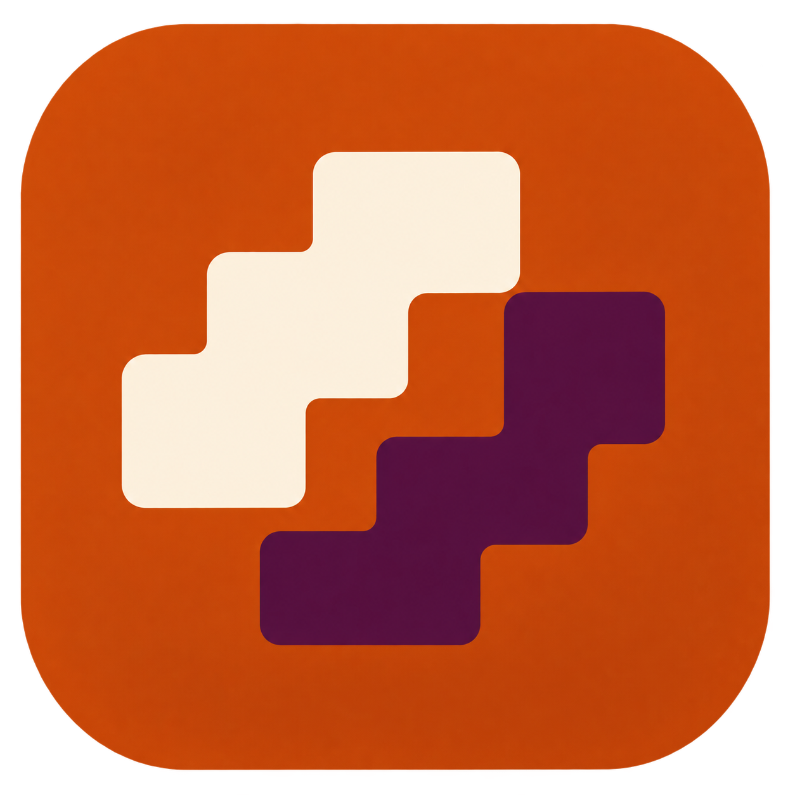
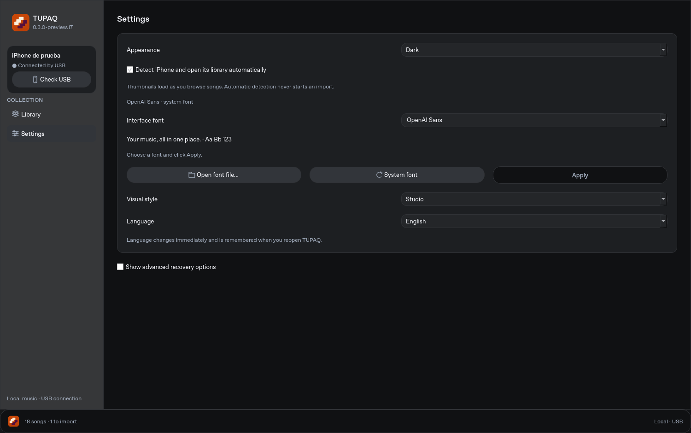
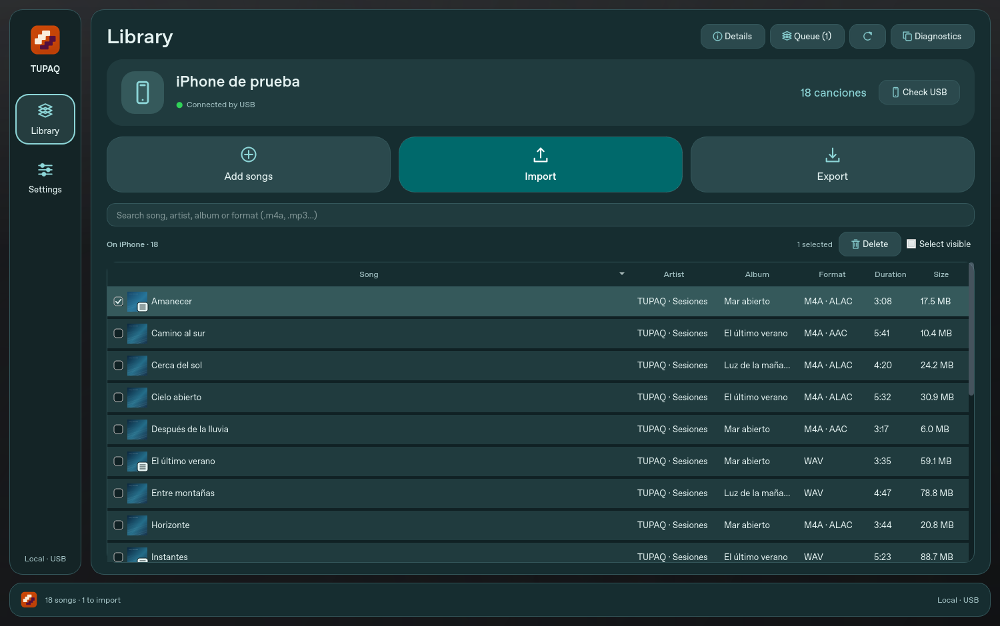
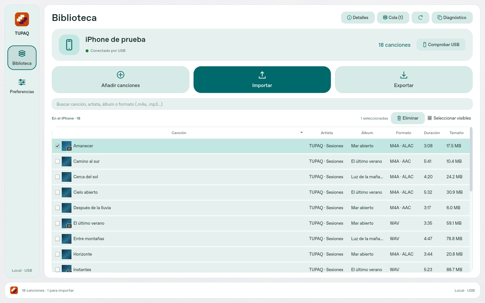
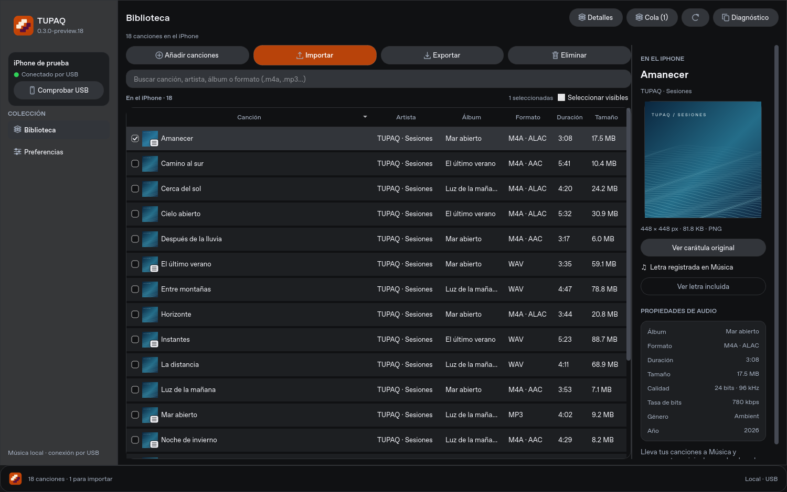
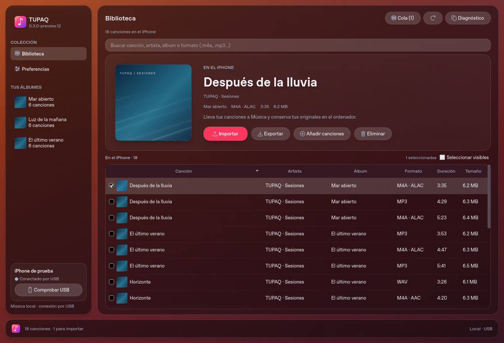
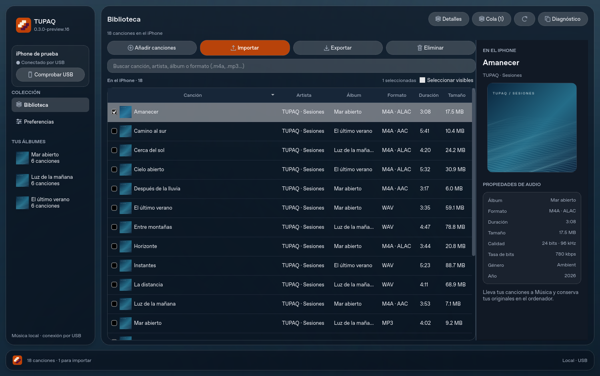

# TUPAQ



Antes llamado Importios. El código interno conserva el módulo `importios`; el repositorio es `SRJW/TUPAQ`.

Aplicación de escritorio para Windows y macOS, en español, con ventana propia.
El objetivo es importar música local a la app Música del iPhone sin usar la
aplicación iTunes ni 3uTools.

El usuario confirmó la lectura y la importación con metadatos y portada en Música del iPhone.
La **0.3.0-preview.17** conserva la biblioteca visible mientras se actualiza después
de una importación, incluidas selección, marcas, posición de lectura y carátulas.
Si falla la lectura, mantiene la última vista válida e indica que no está actualizada.
La comprobación de título, artista y álbum acepta las dos representaciones
Unicode equivalentes de los acentos. Si los metadatos aún no coinciden, realiza
hasta tres lecturas finales sin reenviar la música; conserva las observaciones
y sigue rechazando las diferencias reales. El diagnóstico identifica los campos
afectados sin incluir sus valores. Revisar operación pendiente permite comprobar
un envío anterior sin volver a insertar canciones.
La identidad **Encuentro** está integrada en la barra lateral, barra inferior,
ventana y aplicación, con iconos nativos ICO para Windows e ICNS para Mac.
La vista previa lee la **carátula original**, conserva sus proporciones y muestra
su resolución, formato y peso original. «Ver carátula original» abre una vista
al 100% con desplazamiento. Las miniaturas de la tabla siguen siendo pequeñas.
Se elimina «Tus álbumes» del lateral.

Un icono de letra sobre la miniatura identifica las letras detectadas. Se leen
USLT/SYLT en MP3, WAV y AIFF y ©lyr en M4A; el inspector permite consultarlas.
Importar conserva el audio original y sus letras incrustadas sin modificarlos.
**Mostrar esas letras en Música del iPhone aún no está garantizado**: su registro
nativo requiere una parte de transferencia separada cuyo contrato no está validado.
El inspector distingue letras incrustadas, registradas en el catálogo y disponibles
en línea; no confunde estos estados. [Alcance y límites](docs/LETRAS.md).

El diseño **Estudio** sigue la nueva referencia de tres columnas: dispositivo y
navegación a la izquierda, biblioteca compacta en el centro y carátula con
propiedades a la derecha. Las acciones de importar y exportar están juntas;
Detalles permite ocultar el panel y ampliar la tabla. Las cabeceras siguen
ordenando y las casillas conservan su selección al buscar y actualizar.

Preferencias → Estilo visual ofrece Estudio, Nocturno, Aurora y Atardecer.
Estudio usa tonos neutros y acentos naranja. Las propiedades de audio muestran
frecuencia, bits y tasa de bits únicamente cuando se conocen; el resto muestra —.
No se añaden controles de reproducción ni edición de etiquetas al copiar el diseño.
La barra inferior conserva progreso y Cancelar. La tabla sigue siendo virtual,
sin motor web ni desenfoque continuo.
Windows permite elegir cualquier familia instalada o cargar una fuente de archivo,
ver una muestra y pulsar **Aplicar** para cambiar toda la interfaz. En Mac se usa
siempre la fuente del sistema. Hay [propuestas concretas para continuar](docs/MEJORAS-PROPUESTAS.md).
En **Preferencias → Idioma** puedes elegir **Español** o **English**. El cambio
es inmediato, se conserva al cerrar y alcanza navegación, cabeceras, diálogos,
ayudas y mensajes de progreso/error, sin reiniciar ni vaciar la cola. Los metadatos
de las canciones, nombres de dispositivos y códigos técnicos no se traducen.
Los selectores nativos de archivos también dependen del idioma del sistema operativo.
Véase [cómo transferir y recuperar](docs/TRANSFERENCIAS.md).

**Tipografía:** en Windows, Preferencias permite seleccionar familias instaladas y
archivos TTF, OTF, TTC u OTC de hasta 128 MiB. Elegir una fuente no cambia la interfaz
hasta pulsar Aplicar. Fuente del sistema también requiere Aplicar; la elección se
conserva entre aperturas. El archivo de una fuente cargada debe seguir disponible.
En macOS se utiliza la fuente nativa y no se ofrecen controles para sustituirla.
No se redistribuyen archivos de fuentes de Apple. Las capturas se generan en Linux
con su fuente disponible, no con San Francisco.
[Información de Apple sobre sus fuentes](https://developer.apple.com/fonts/).













## Descargar y abrir

[Versiones descargables](https://github.com/SRJW/TUPAQ/releases) ·
[Instrucciones de descarga](DESCARGAR.md)

- Windows 11: abre `TUPAQ.exe` con doble clic.
- Mac con chip Apple: abre `TUPAQ-macOS-arm64.dmg` y copia la app a Aplicaciones.
- Mac Intel: usa `TUPAQ-macOS-x86_64.dmg`.

No se necesita instalar Python ni abrir una terminal. La aplicación tiene una
ventana propia y no usa el navegador. Las descargas aparecen cuando GitHub
termina la compilación de cada plataforma. Todavía no tienen firma de desarrollador ni
notarización de Apple.

## Funciones actuales

- Interfaz nativa inspirada en Apple: barra lateral, tipografía del sistema y apariencia Sistema/Claro/Oscuro en Preferencias. Sin motor web ni animaciones.
- Detección USB automática cada cinco segundos cuando la conexión está libre. Lee la biblioteca al conectar el teléfono y al reconectarlo; no vuelve a copiar el catálogo en cada sondeo. Se puede desactivar en Preferencias. Nunca importa automáticamente.
- Casillas persistentes por canción al ordenar o buscar, selección de visibles y contador de marcadas. Exportar y Eliminar usan las casillas; hacer clic en una fila abre sus detalles.
- Tabla de biblioteca con celdas dibujadas bajo demanda. Cabeceras clicables para ordenar por canción, artista, álbum, formato, duración, tamaño. Duración y tamaño se ordenan numéricamente conservando la selección por canción.
- Dos secciones en la misma página: canciones del iPhone y cola del ordenador. Importar y exportar están juntos.
- Descargadas por defecto: usa estado local y el indicador de descarga protegida de suscripción; nube y pendientes no se presentan como canciones descargadas; las rutas ausentes se ocultan tras comprobar su carpeta USB. No fusiona por título: solo evita contar dos referencias al mismo archivo físico.
- Buscar por canción, artista, álbum y formato/codec, con o sin punto en la extensión.
- Eliminar: hasta 100 canciones marcadas por operación, con confirmación y vinculación al dispositivo, biblioteca e IDs leídos. Usa delete_track nativo; comprueba la desaparición de los objetivos y la conservación de IDs y metadatos de las demás canciones. No borra archivos por AFC; iOS gestiona la limpieza del audio. Función nueva pendiente de validación física.
- Formato y tamaño: catálogo como lectura inicial, verificación de cabeceras y stat por USB para filas visibles. Se muestra — cuando no hay información; no se descarga cada audio completo para mostrarlo.
- Errores de conexión por etapa y botón **Copiar diagnóstico**, también cuando la consulta devuelve cero resultados. Incluye versión, recuentos por tipo y presencia/tamaño del WAL, sin títulos ni credenciales ni identificadores del dispositivo.
- Las canciones sin fila de metadatos complementarios se muestran como «Sin título» en lugar de descartarse.

- Elegir o arrastrar MP3, WAV, M4A (AAC o ALAC) y AIFF; comprobar el códec real.
- Miniaturas de portadas incrustadas, en la lista y en el panel de preparación.
  Sin portada se muestra una nota musical. La miniatura acompaña el progreso de importación.
- Leer título, artista, álbum y duración sin cambiar el original.
- Omitir duplicados por contenido, quitar elementos y exportar CSV.
- Consultar dispositivos USB mediante **ListDevices** del servicio local de Apple.
  No inicia sesiones de sincronización, emparejamientos ni escrituras al iPhone.
- **Biblioteca** se abre al detectar el iPhone; **Actualizar** permite releerla. Usa la autorización de confianza existente y AFC
  para obtener dos lecturas consecutivas coincidentes del catálogo y su WAL.
  Si están cambiando, repite hasta tres intentos; otros errores no se reintentan.
  Conserva una sola copia del par coincidente. Consulta una copia local con SQLite en modo de solo lectura
  y muestra título, artista, álbum y duración. No escribe en la biblioteca remota.
  El usuario confirmó la lectura de título, artista, álbum y duración en su iPhone.
- Miniaturas de la biblioteca: consulta los originales de Artwork y, si faltan, los tags incrustados mediante lecturas parciales por USB. Solo las filas visibles y con caché de hasta 96 iconos de 224 px; no descarga todo el audio ni consulta URLs. Si no hay portada accesible, muestra una nota musical.
- **Importar al iPhone**: toma archivos del ordenador, guarda el catálogo y las
  preferencias de biblioteca localmente, conserva la identidad existente y envía
  un delta ATC firmado. Comprueba después las canciones nuevas, la conservación
  de las anteriores y los bytes de los archivos. No escribe SQLite en el teléfono.
- **Exportar selección**: copia los originales accesibles por USB a la carpeta
  elegida, comprueba SHA-256 y evita sobrescribir archivos existentes. Los archivos
  protegidos se copian conservando su protección; no hay descifrado ni conversión.
- **Cancelar**: detiene la preparación antes del envío de cambios y la exportación entre lecturas, conservando archivos completos y retirando temporales. Una vez iniciado el envío de metadatos a Música, finaliza y verifica el lote actual antes de detenerse; no ofrece interrupción inmediata ni reversión.
- **Actualizar portadas y fecha**: usa originales y registros de TUPAQ, verifica los audios y envía solo metadatos/portadas de esas canciones. No duplica filas ni vuelve a subir audio; hasta 49 canciones por lote.
- **Completar importación pendiente**: recuperación experimental con el original y el registro local. Para una canción pendiente representada, solicita el audio sin volver a insertar metadatos; no garantiza aceptación de esa sesión por un iPhone físico. Si el estado no coincide, se detiene.
- **Revisar importación**: vuelve a comprobar una operación cuya confirmación se
  perdió. Una operación sin comprobar bloquea otra importación; no se reenvía sola.
- Calcular firmas candidatas de 21 bytes con un protocolo de solicitud fijo,
  usando una adaptación con licencia MIT de rustunes. Cuatro vectores conocidos
  coinciden; eso no demuestra aceptación por un dispositivo real.

En Windows, la detección necesita el controlador/servicio de Apple. Tener ese
controlador no requiere abrir iTunes para usar TUPAQ. En macOS se consulta
el servicio usbmuxd del sistema. Detectar un dispositivo no confirma la confianza,
la versión de iOS ni la compatibilidad de importación.

La cola del ordenador vive en memoria y se pierde al cerrar. Las importaciones
conservan una copia local del catálogo y un registro para comprobación posterior. Los archivos permanecen en su
ubicación original; no se convierten ni se envían a Internet. Límite por archivo:
256 MB. Se necesita Internet solo para obtener el programa y, si se trabaja desde
el código fuente, instalar las dependencias.

## Recursos de la interfaz

La interfaz usa Qt Widgets nativo y carga el componente de comunicación con iOS
al solicitar la biblioteca. No tiene motor de navegador. La consulta ligera ListDevices
se hace cada cinco segundos, con las lecturas suspendidas durante una transferencia.
La biblioteca completa se lee una vez por conexión; si falla, se espera al menos
20 segundos antes de reintentar. La tabla conserva sus filas y dibuja celdas bajo demanda.
Se prueba el acceso a la primera y última canción de una lista sintética de
100.000 filas.

Medición orientativa en Linux, desde el código, con Qt offscreen y ventana vacía:
78,1 MiB RSS (0.3.0-preview.1) y 0 % CPU durante una muestra de tres segundos en reposo.
No es una medición del EXE/DMG en Windows/macOS ni del coste de cargar una
biblioteca; ese consumo aún debe medirse en esos equipos.

## Desarrollo

Python 3.11 o posterior. Los usuarios de los paquetes EXE/DMG no necesitan esto.

```sh
python3 -m venv .venv
.venv/bin/python -m pip install -r requirements-desktop.txt
.venv/bin/python -m importios.native
```

Windows tiene `windows/Abrir-TUPAQ.bat` y macOS `Abrir-TUPAQ.command`
para ejecución desde el código. La antigua interfaz web se conserva como utilidad
de desarrollo: `.venv/bin/python -m importios --no-browser`.

## Comprobaciones y compilación

```sh
.venv/bin/python -m unittest discover -s tests -v
QT_QPA_PLATFORM=offscreen .venv/bin/python -m importios.native --smoke-fixtures tests/fixtures
.venv/bin/python -m pip install -r requirements-build.txt
.venv/bin/python scripts/build_desktop.py
```

La suite incluye pruebas de formatos, HTTP local, descubrimiento USB simulado,
paquetes de investigación, firmas candidatas, conexión automática y portadas remotas. La prueba nativa comprueba una
ventana Qt real, lectura en un hilo de trabajo, los AAC/ALAC dentro de M4A, portadas, duplicados,
archivos dañados, CSV, quitar/vaciar y las firmas. En Linux se ha probado también
el ejecutable empaquetado. Windows y macOS se validan en sus runners de GitHub;
no se deben dar por aprobados hasta comprobar los resultados de cada ejecución.

GitHub compila en Windows x64, Mac Apple Silicon y Mac Intel, prueba cada paquete
y verifica/monta los DMG. Cada paquete se publica de forma independiente cuando
pasa sus comprobaciones; una plataforma fallida puede quedar sin descarga. Los pushes a `main` y las ejecuciones manuales compilan la app. Las etiquetas
`v…` publican versiones preliminares con
los paquetes como Assets. Las compilaciones normales guardan artefactos 30 días.

## Investigación y atribución

- [Transferencias: alcance, comprobaciones y límites](docs/TRANSFERENCIAS.md).
- [Corrección de cero canciones: código interno de MediaLibrary frente a MediaPlayer](research/LECTURA-MEDIA-TYPE.md).

- [Hallazgos de las DLL aportadas y de la implementación independiente](research/IMPLEMENTACION-INDEPENDIENTE.md).
- [Análisis inicial de 3uTools](ANALISIS-3UTOOLS.md).
- [Avisos de terceros](third_party/README.md).

Las DLL y ejecutables de Apple/3uTools no se incluyen en el proyecto ni en los
paquetes. La firma independiente no es una llamada a sus binarios ni a sus servidores.
