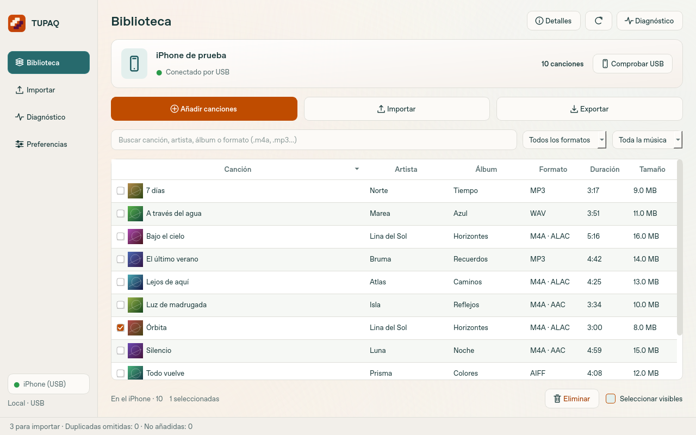
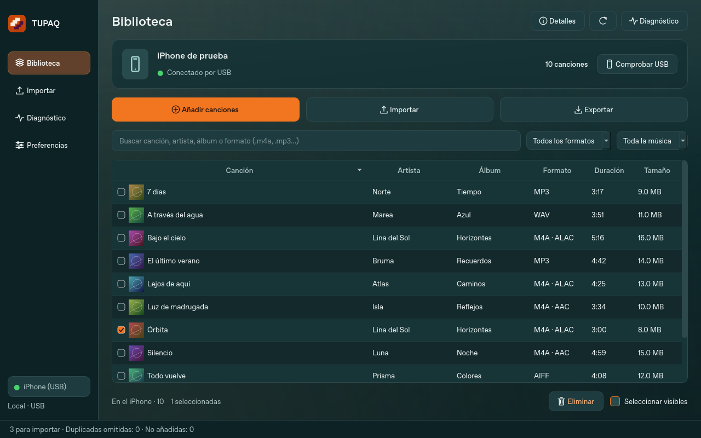

# TUPAQ


Gestiona por USB la música del iPhone desde Windows o macOS: importa canciones
del ordenador, exporta originales y elimina canciones seleccionadas de Música.
Aplicación nativa, con ventana propia, sin navegador ni necesidad de instalar Python.

La **0.3.0-preview.27** corrige las importaciones interrumpidas por `AttributeError`,
la prioridad de las carátulas y el estilo de los controles.
[Detalles de la corrección y recuperación](docs/CORRECCIONES-26.md).

Desde la 0.3.0-preview.25, TUPAQ adopta las referencias claras y oscuras: navegación lateral,
superficies marfil o verde oscuro, selección verde azulado y acentos naranjas.
**Windows y Mac usan siempre la fuente de su sistema**; no hay selector ni carga
de fuentes. Los controles y columnas reservan el ancho real del texto, sin comprimirlo.





[Ver las cuatro pantallas en ambos temas](docs/DISENO-25.md).
Las capturas del repositorio usan datos sintéticos y la fuente nativa del entorno
que las renderiza. GitHub Actions guarda también capturas por plataforma.

## Descargar y abrir

[Versiones descargables](https://github.com/SRJW/TUPAQ/releases) ·
[Cómo descargar](DESCARGAR.md)

- **Windows x64:** abre `TUPAQ.exe`.
- **Mac Apple Silicon:** abre `TUPAQ-macOS-arm64.dmg` y copia TUPAQ a Aplicaciones.
- **Mac Intel:** utiliza `TUPAQ-macOS-x86_64.dmg`.

Cada descarga aparece cuando su plataforma termina de compilarse y verificarse.
Windows necesita el servicio/controlador USB de Apple que permite acceder al iPhone;
no es necesario abrir iTunes ni 3uTools. Los paquetes todavía no llevan firma de
Windows ni notarización de Apple.

## Las cuatro vistas

**Biblioteca:** lectura automática al conectar el iPhone, miniaturas, selección con
casillas, búsqueda por título/artista/álbum/formato y filtros por formato, portada
o letra. Las cabeceras ordenan por canción, artista, álbum, formato, duración y
tamaño. Las marcas y la posición se conservan al navegar y actualizar. Exportar
usa las casillas; Eliminar pide confirmación y comprueba el resultado.

**Importar:** elegir archivos o carpetas completas, arrastrar y soltar, preparar la
cola, ver el estado por canción y el progreso real. Importa MP3, WAV, M4A con AAC
/ALAC y AIFF. FLAC no se incluye. La cola permite quitar, vaciar y exportar CSV.
Hay historial privado de operaciones y pausa/reanudación entre lotes o archivos.
Cancelar espera a terminar el lote nativo que ya empezó a modificar Música.

**Diagnóstico:** nombre, modelo y versión de iOS cuando el iPhone los comunica;
conexión USB, catálogo y permisos de lectura comprobados; capacidad y espacio libre
del volumen de datos por AFC. Comprobar selección/todo lee los audios completos
sin modificar el dispositivo. Compara SHA-256 cuando existe un recibo anterior de
TUPAQ; sin recibo no afirma haber autenticado el archivo. Los datos desconocidos
quedan pendientes, sin inventar velocidad USB ni estados de salud.

**Preferencias:** apariencia Claro/Oscuro/Sistema, acento naranja opcional, reducir
transparencia/movimiento, carpeta inicial para elegir/exportar música, política de
títulos, envío de carátulas, carátulas en copias exportadas, idioma Español/English
y sincronización. La fuente del sistema se aplica a toda la interfaz.

La **importación automática es opcional y está desactivada inicialmente**. Solo
se inicia después de preparar archivos con el mismo iPhone conectado y la biblioteca
leída; el dispositivo se vuelve a comprobar antes de escribir. La actualización
opcional detecta cambios del catálogo cada 30 segundos mediante dos consultas de
atributos; relee la biblioteca solo cuando cambia y conserva la vista anterior.
Se suspende durante preparación, transferencias y lecturas que compiten por USB.

## Música y comprobaciones

Los originales del ordenador se conservan. La numeración opcional incoherente
(`0/12`, `9/3`) no bloquea la importación: se conserva la posición válida y se
omite el total incoherente en los metadatos enviados. Se verifican los audios,
metadatos, portada y resultado del catálogo según las operaciones implementadas.

Hasta **50.000 canciones por selección**, divididas en lotes nativos de hasta
49 canciones/2 GiB para importar o 100 para eliminar. Máximo 256 MiB por archivo
importado y 100.000 registros en el catálogo admitido. Exportar conserva su límite
independiente de 1.000 archivos. Un fallo detiene los siguientes lotes.

La exportación normalmente conserva los bytes originales. La opción de incrustar
carátulas completa solo las copias exportadas que no tengan portada, después de
verificar el audio original por USB. No sobrescribe carátulas existentes ni archivos
previos. Solo se importan y exportan MP3, WAV, M4A (AAC/ALAC) y AIFF.

Se conserva el catálogo antes de cada cambio. **Esa copia no incluye todos los
audios** y no es una restauración automática. Los recibos permiten comprobar
operaciones interrumpidas sin reenviar música a ciegas. El historial es agregado
(fecha, operación, estado y recuentos), separado de los respaldos de recuperación.

Las letras incrustadas se detectan, se conservan y se pueden consultar. **Su aparición
en Música del iPhone todavía no está garantizada**: falta validar el contrato nativo
separado. [Letras](docs/LETRAS.md) · [Transferencias y límites](docs/TRANSFERENCIAS.md).

## Validación y desarrollo

**215 pruebas automáticas** en la revisión 25, incluidas preferencias reales,
exportación con carátulas, diagnóstico de corrupción, cambio de teléfono y pausa
entre transacciones. Se prepararon 10.000 archivos en la interfaz nueva. Las pruebas
previas importaron y eliminaron 10.000 canciones en un iPhone simulado, conservando
el audio ajeno a la selección. [Informe reproducible](docs/ESTRES.md).

Los resultados simulados no sustituyen la prueba física por USB. El usuario ha
confirmado lectura e importación con metadatos y carátula en versiones anteriores.
GitHub prueba los ejecutables nativos de Windows y ambos Mac antes de publicarlos;
verifica y monta los DMG. Los artefactos de compilación y capturas se conservan
30 días en Actions. Los pushes a `main` compilan; las etiquetas `v…` publican.

```bash
python -m venv .venv
.venv/bin/python -m pip install -r requirements-build.txt
QT_QPA_PLATFORM=offscreen .venv/bin/python -m unittest discover -s tests -v
.venv/bin/python -m importios.native
.venv/bin/python scripts/build_desktop.py
```

En Windows utiliza `.venv\Scripts\python.exe` y omite `QT_QPA_PLATFORM=offscreen`
para abrir la ventana. El nombre interno del módulo sigue siendo `importios`;
el repositorio y la aplicación se llaman TUPAQ.

## Investigación y atribución

[Implementación independiente](research/IMPLEMENTACION-INDEPENDIENTE.md) ·
[Lectura de MediaLibrary](research/LECTURA-MEDIA-TYPE.md) ·
[Análisis de 3uTools](ANALISIS-3UTOOLS.md) · [Avisos de terceros](third_party/README.md).
No se distribuyen DLL ni ejecutables de Apple/3uTools ni archivos de fuentes
propietarias. La firma independiente no llama a sus binarios ni servidores.
