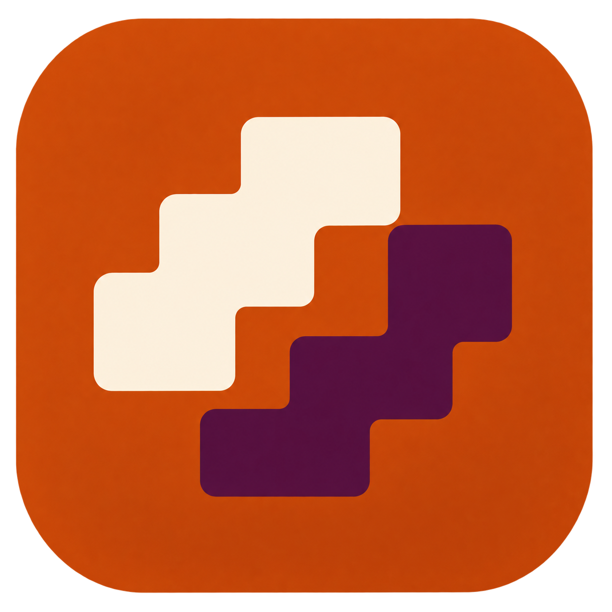
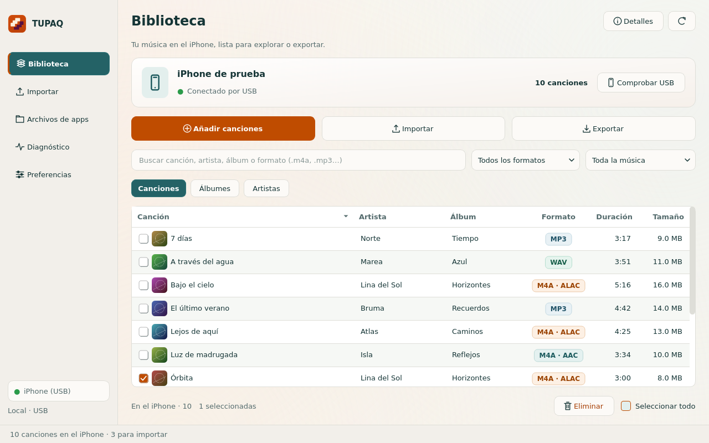
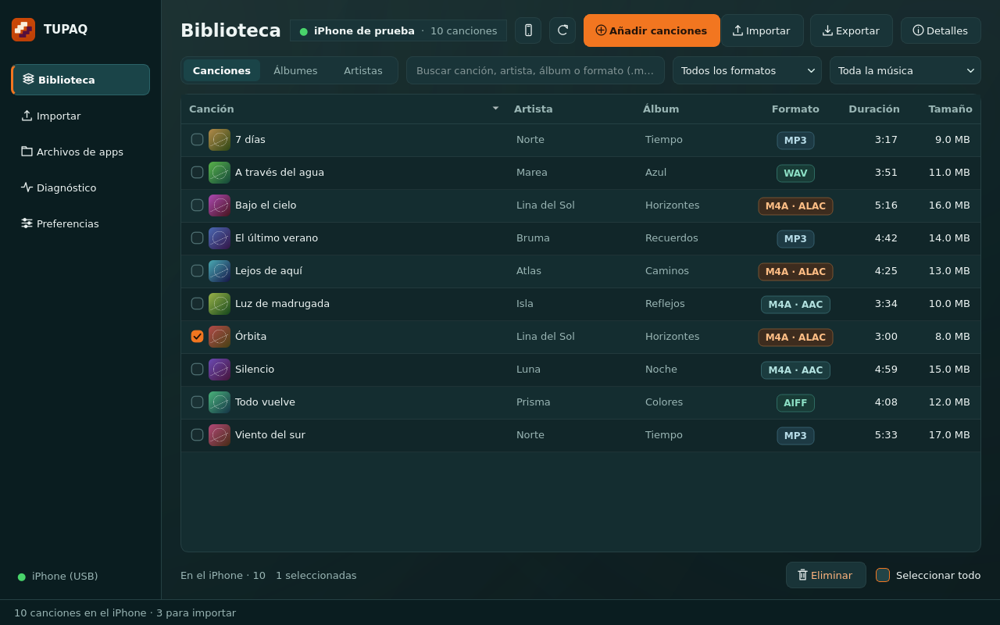

# TUPAQ



Gestiona por USB la música y los archivos compartidos del iPhone desde Windows o
macOS: importa canciones del ordenador, exporta originales (planos u organizados
por artista y álbum), elimina canciones de Música, explora la carpeta `/Documents`
de apps compatibles y consulta diagnósticos reales del dispositivo (incluida la
salud de la batería). Aplicación de escritorio nativa, con ventana propia, sin
navegador ni necesidad de instalar Python.

La versión actual (**0.3.0-preview.42**) mejora la estabilidad de la copia
**Música → carpeta del iPhone** con reconexión automática, modo secuencial de un
solo canal ante cortes USB y escrituras de 256 KB, sobre la corrección de
certificados SSL en macOS para avisos de actualización, la copia bidireccional
entre **Música** y carpetas de iOS visibles en **Archivos**, el resumen de peso
total en *Biblioteca*, las casillas planas redondeadas, el rediseño ligero de las
cinco vistas y todas las funciones existentes: **Archivos de apps** con buscador,
renombrado (`F2`) y política de conflictos, telemetría real de **Batería**,
conversión opcional de FLAC/OGG/Opus/WMA con `ffmpeg`, exportación organizada e
incremental sin límite de 1.000 canciones, detector de duplicados, editor no
destructivo de metadatos y portada antes de importar, lectura y exportación
`.m3u8` de playlists, vista por **Álbumes / Artistas** y vista previa de audio.

**Windows y macOS usan siempre la fuente nativa de su sistema**; no hay selector
ni carga manual de fuentes. Los controles y columnas reservan el ancho real del
texto en español e inglés, sin recortes.





[Ver las cinco pantallas en ambos temas](docs/DISENO-25.md).
Las capturas del repositorio usan datos sintéticos y la fuente nativa del entorno
que las renderiza. GitHub Actions guarda también capturas por plataforma.

## Descargar y abrir

[Última versión (v0.3.0-preview.42)](https://github.com/SRJW/TUPAQ/releases/tag/v0.3.0-preview.42) ·
[Todas las versiones](https://github.com/SRJW/TUPAQ/releases) ·
[Cómo descargar](DESCARGAR.md)

- **Windows 11 (x64):** abre `TUPAQ.exe`.
- **macOS Apple Silicon (M1/M2/M3/M4):** abre `TUPAQ-macOS-arm64.dmg` y copia TUPAQ a Aplicaciones.
- **macOS Intel (x86_64):** utiliza `TUPAQ-macOS-x86_64.dmg`.

Cada descarga se publica cuando su plataforma termina de compilarse y pasa sus
pruebas en GitHub Actions. Windows necesita el servicio/controlador USB de Apple
para detectar el iPhone; no es necesario abrir iTunes ni 3uTools. Los paquetes
todavía no llevan firma de Windows ni notarización de Apple.

Desde **Preferencias → Sincronización**, TUPAQ puede comprobar si existe una
versión más reciente en GitHub Releases y mostrar un aviso con enlace a la página
oficial de descarga; nunca descarga ni ejecuta binarios automáticamente.

## Las cinco vistas

### Biblioteca
- Lectura automática por USB al conectar el iPhone, miniaturas de carátula,
  insignias de formato y selección persistente con casillas.
- Conmutador **Canciones / Álbumes / Artistas** para explorar como tabla o en
  cuadrícula de discos y artistas (permite marcar álbumes o artistas completos de
  un clic y hacer doble clic para filtrar sus canciones).
- Búsqueda por título, artista, álbum o formato y filtros por **Formato**
  (`M4A`, `MP3`, `AAC`, `ALAC`, `WAV`, `AIFF`), **Contenido** (con carátula, con
  letra o **Posibles duplicados**) y **Playlists** leídas de `MediaLibrary.sqlitedb`.
- El filtro de formato verifica extensión y cabecera real del audio también
  durante la exportación para que no se cuele ningún formato distinto.
- Selección rápida contextual (**Seleccionar todo**, **Seleccionar todos los MP3**,
  **Seleccionar resultados**), resumen en vivo del **peso de la selección y de la
  biblioteca**, ordenación por columnas y eliminación con confirmación.
- Menú **Exportar** con dos destinos: **Exportar al ordenador…** o **Copiar a
  carpeta del iPhone…** (copia canción por canción a `/Documents` de una app
  compatible visible en la app *Archivos* de iOS, sin guardar copias en tu PC).
- Panel **Detalles** con carátula original al 100%, letra incluida, propiedades
  técnicas del audio y botón **Escuchar vista previa** para reproducir la canción
  (tanto local en la cola como desde el iPhone por USB).

### Importar
- Elegir archivos o carpetas completas, o arrastrar y soltar directamente sobre la
  ventana, con progreso real y estado por canción.
- **Formatos nativos:** `MP3`, `WAV`, `M4A (AAC / ALAC)` y `AIFF`.
- **Conversión automática opcional (FLAC y otros):** activable en Preferencias
  usando `ffmpeg` para convertir `.flac`, `.ogg`, `.oga`, `.opus`, `.wma`, `.mka`
  y `.webm` al vuelo a **M4A · ALAC** (sin pérdida) o **M4A · AAC (256 kbps)** en
  una copia temporal, conservando metadatos, portada y letra sin modificar los
  archivos originales.
- **Detector de duplicados antes de importar:** señala con estado `Ya en el iPhone`
  las canciones de la cola que ya existen en la biblioteca del dispositivo y ofrece
  el botón **Quitar repetidas**.
- **Editor de metadatos y portada antes de importar:** botón **Editar** para
  ajustar título, artista, álbum, artista del álbum, género, año, número de pista/disco
  o portada personalizada únicamente para el envío al iPhone, dejando intactos los
  archivos originales del ordenador.
- Exportación de la cola a CSV, historial privado agregado de operaciones, pausa y
  reanudación entre lotes o archivos, y cancelación segura (espera a terminar un
  lote ATC que ya empezó a escribir).

### Archivos de apps
- Explora y gestiona la carpeta `/Documents` de las aplicaciones instaladas en el
  iPhone con intercambio de archivos habilitado en iOS (`InstallationProxy` +
  `HouseArrestService`), para cualquier tipo de archivo.
- Barra de migas de pan clicables (`Documentos › …`), navegación por subcarpetas,
  arrastrar y soltar archivos o carpetas, crear nuevas carpetas, exportar y
  eliminar con confirmación.
- **Enviar a Música:** selecciona canciones o carpetas dentro de `/Documents` para
  cargarlas directamente en la cola de *Importar* (con conversión opcional de FLAC,
  detector de duplicados y editor de metadatos) y enviarlas a la app Música del
  iPhone sin alterar tus archivos originales ni dejar copias en el PC.
- **Buscador** en vivo dentro de la carpeta actual, botón y atajo **`F2` para
  renombrar** archivos o carpetas, y selector de política de conflictos
  (**Si existe: Omitir / Renombrar / Reemplazar**) para subidas y exportaciones,
  con verificación de integridad SHA-256.

### Diagnóstico
- Muestra nombre, modelo y versión de iOS comunicados por el dispositivo, volumen
  de almacenamiento de datos por AFC y estado de las comprobaciones de conexión,
  base de datos, permisos de catálogo e integridad con recibos propios.
- **Tarjeta de Batería:** consulta de solo lectura vía `DiagnosticsService`
  (`IOPMPowerSource`) con salud real en %, ciclos de carga, capacidad máxima real
  frente a capacidad de diseño (mAh), carga actual, temperatura (°C) y voltaje (V).
  Si el dispositivo no entrega algún dato, queda como pendiente sin inventar cifras.
- **Comprobar lectura de audios / Comprobar selección:** lee los audios completos
  sin modificar el iPhone y contrasta SHA-256 contra recibos previos de TUPAQ.
- Opciones avanzadas de recuperación ocultas por defecto (revisar operación
  pendiente, completar importación pendiente, actualizar portadas y fecha, abrir
  respaldos del catálogo).

### Preferencias
- **Apariencia:** Claro / Oscuro / Sistema (con miniatura partida), acento naranja
  opcional de TUPAQ, reducir transparencia y reducir movimiento.
- **Rutas de biblioteca y exportación:** carpeta inicial, organización al exportar
  (**Todo en la misma carpeta** u **Organizar por Artista / Álbum** como
  `Artista/Álbum/01 - Canción.ext`) y **modo respaldo incremental** (omite lo ya
  exportado sin crear duplicados `(2)`). Al exportar una playlist filtrada guarda
  también su archivo `.m3u8`.
- **Metadatos:** envío de letras incrustadas, política de título (conservar
  etiquetas o usar nombre de archivo), activación de conversión automática de FLAC
  y otros formatos, selector de códec (`ALAC` / `AAC 256 kbps`) y ruta opcional de
  `ffmpeg` (con detección automática).
- **Carátulas:** envío de carátulas al catálogo e incrustación opcional en copias
  exportadas sin modificar el audio del iPhone.
- **Idioma:** cambio inmediato entre Español e English conservando la vista, la
  cola y la selección.
- **Sincronización y actualizaciones:** detección automática del iPhone,
  importación automática opcional (desactivada inicialmente y sujeta a coincidencia
  del mismo dispositivo), actualización periódica al detectar cambios en el
  catálogo cada 30 segundos y comprobación de actualizaciones en GitHub Releases.

## Música, letras y comprobaciones

Los originales del ordenador nunca se modifican (ni al importar, ni al editar
metadatos/portada en la cola, ni al convertir FLAC a una copia temporal). La
numeración opcional incoherente (`0/12`, `9/3`) no bloquea la importación: se
conserva la posición válida y se omite el total incoherente.

- **Límites operativos:** hasta **50.000 canciones por selección** para importar,
  exportar o eliminar; la importación se divide en lotes nativos de hasta 49
  canciones / 2 GiB y la eliminación en lotes de hasta 100. Máximo 256 MiB por
  archivo nativo (512 MiB de origen para conversión con `ffmpeg`) y 100.000
  registros en el catálogo admitido. Un fallo detiene los lotes restantes.
- **Exportación fiel:** conserva los bytes originales y verifica el hash tras la
  lectura USB. Con *Incrustar carátulas* completa solo copias locales que no
  tengan portada; con *Respaldo incremental* omite archivos ya presentes en el
  destino; con una playlist activa conserva su orden y escribe `<Playlist>.m3u8`.
- **Respaldo y recibos:** se guarda una copia del catálogo antes de cada cambio.
  **Esa copia no incluye todos los audios** ni es una restauración automática;
  sirve junto a los recibos para verificar o completar operaciones interrumpidas
  sin reenviar canciones a ciegas.
- **Letras incrustadas:** desde `0.3.0-preview.30` se envían letras de texto plano
  incrustadas en canciones nuevas con verificación de texto y checksum en el
  catálogo (confirmado por el usuario en Música del iPhone). **El karaoke
  sincronizado no funciona en los ensayos actuales**: tanto LRC como TTML Line se
  muestran como letra estática en Música.
  [Implementación, pruebas y límites de letras](docs/LETRAS-INVESTIGACION.md) ·
  [Letras](docs/LETRAS.md) · [Transferencias y límites](docs/TRANSFERENCIAS.md).

## Validación y desarrollo

La revisión **0.3.0-preview.42** cuenta con **303 pruebas automáticas** que
cubren lectura de catálogo y playlists, conversión real de FLAC → ALAC/AAC con
`ffmpeg`, exportación organizada e incremental con `.m3u8`, editor no destructivo
de metadatos y carátula, detección de duplicados, telemetría de batería, aviso de
actualizaciones, operaciones de **Archivos de apps** (renombrar, buscar y
políticas de conflicto), traducciones ES/EN y coherencia visual en claro y oscuro.
Las pruebas de estrés previas validaron 10.000 canciones en la cola y en un
iPhone simulado ([informe reproducible](docs/ESTRES.md)).

Los resultados simulados no sustituyen la prueba física por USB con un iPhone
real. GitHub Actions ejecuta la suite, renderiza capturas y compila/verifica los
ejecutables reales de Windows y ambos macOS (incluyendo montaje y prueba del DMG)
antes de publicar. Los pushes a `main` compilan; las etiquetas `v…` publican en
Releases.

```bash
python -m venv .venv
.venv/bin/python -m pip install -r requirements-build.txt
QT_QPA_PLATFORM=offscreen .venv/bin/python scripts/run_tests.py
.venv/bin/python -m importios.native
QT_QPA_PLATFORM=offscreen .venv/bin/python scripts/preview_desktop.py --output /tmp/tupaq-preview
.venv/bin/python scripts/build_desktop.py
```

En Windows utiliza `.venv\Scripts\python.exe` y omite `QT_QPA_PLATFORM=offscreen`
para abrir la ventana. Para la conversión opcional de FLAC/OGG/Opus/WMA en tu
equipo necesitas `ffmpeg` en el `PATH` (por ejemplo `winget install Gyan.FFmpeg`
en Windows o `brew install ffmpeg` en macOS) o indicar su ruta en Preferencias.
El nombre interno del paquete Python sigue siendo `importios`; el repositorio y
la aplicación se llaman **TUPAQ**.

## Investigación y atribución

[Implementación independiente](research/IMPLEMENTACION-INDEPENDIENTE.md) ·
[Lectura de MediaLibrary](research/LECTURA-MEDIA-TYPE.md) ·
[Análisis de 3uTools](ANALISIS-3UTOOLS.md) · [Avisos de terceros](third_party/README.md).
No se distribuyen DLL ni ejecutables de Apple/3uTools ni archivos de fuentes
propietarias. La firma independiente no llama a sus binarios ni servidores.
