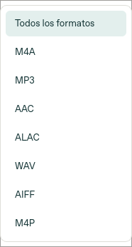
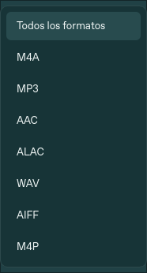

# Correcciones de preview.26

## Operación pendiente y carpeta de respaldos

El SDK fijado, pymobiledevice3 11.49.5, expone `AfcService.makedirs`; no expone `mkdir`. La llamada incorrecta se ejecutaba cuando faltaba `/Airlock/Media/Artwork`, después de anunciar los metadatos y antes de entregar audio. La simulación anterior ofrecía por error ese método inexistente. Ahora las pruebas de regresión usan `create_autospec(AfcService, spec_set=True)` y no aceptan APIs inventadas.

Se corrigió la llamada y se añadió un reintento acotado: solo una operación pendiente, de importación, en fase `metadata-announced`, cuyo fallo anterior era `AttributeError`, y cuyos originales están incluidos en la selección actual. Se cierra primero la sesión fallida. La recuperación existente vuelve a comprobar la identidad, ancla, metadatos, grupos, estado local, originales y hashes. No vuelve a insertar filas pendientes; entrega los archivos solicitados por el protocolo. Si cambió el catálogo o no se puede demostrar el estado, se detiene.

Los respaldos no son una cola que se deba vaciar. Contienen el catálogo previo y el registro de qué se anunció y comprobó. Eliminarlos puede ocultar una operación sin completar. Se conservan todos durante el reintento.

## Carátulas

Miniatura y detalles consultan primero los metadatos del archivo mediante lecturas acotadas. Una imagen incrustada gana a cualquier imagen mayor del catálogo. Si el archivo se pudo leer sin encontrar carátula, no se sustituye por una imagen de álbum. Si el audio no es accesible, solo se admite un enlace de catálogo a esa canción; las colisiones ambiguas se descartan. La preview.28 corrige la comparación de tipos de esta revisión: origen y variante califican el token; el tipo de la canción puede diferir del tipo del original. Véase CORRECCIONES-28.md. Al recibir una previsualización sin imagen, se limpia la imagen anterior.

La opción explícita de completar una carátula al exportar sigue consultando el catálogo; solo actúa en la copia local y mantiene sus verificaciones.

## Controles

Estilo Qt Fusion para métricas coherentes, vistas de lista en todos los desplegables, flechas SVG propias, selección y estados de foco temáticos. Se revisaron también menús, tooltips, casillas, diálogos y desplazamiento horizontal. El CSS usa la familia que realmente resolvió la fuente del sistema; no se carga ni distribuye una fuente personalizada.

Desplegables renderizados con Qt en Linux, no son capturas de un dispositivo físico:

 

## Verificación

224 pruebas automáticas aprobadas en Linux, incluido servidor HTTP local, protocolo simulado con API del SDK real, recuperación de fallo intermedio sin duplicar ni borrar respaldos, importaciones repetidas, rechazo de selección ajena/ancla modificada, imágenes incrustadas frente a caché, enlaces ambiguos y teclado en ambos temas. También prueba de arranque de la interfaz. Esto no equivale a una prueba USB con un iPhone físico.

## Ajuste de formatos en preview.27

Por indicación del usuario se elimina M4P del filtro, de la lista de canciones gestionables y de la exportación. Se valida toda la selección antes de abrir la sesión de exportación. El lector interno conserva la identificación de registros ajenos/no admitidos para comprobar que las operaciones sobre otras canciones no los alteren; no se borra ningún audio del dispositivo. Solo se ofrecen MP3, WAV, M4A (AAC/ALAC) y AIFF.
