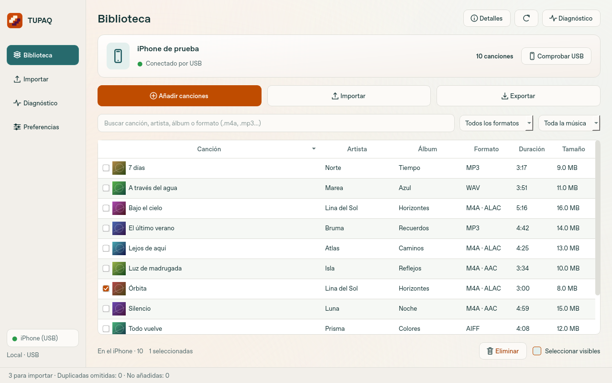
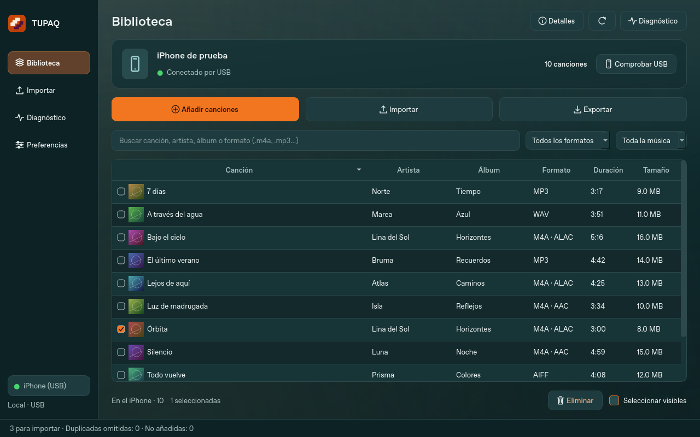
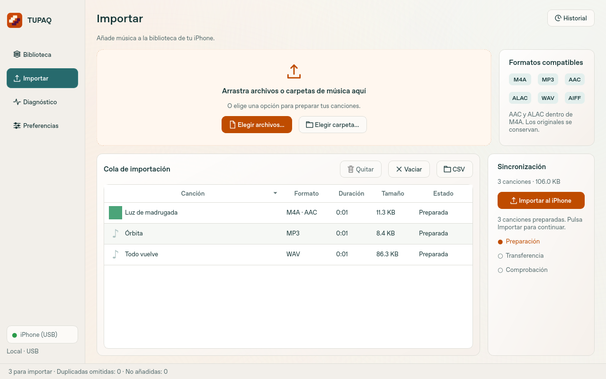
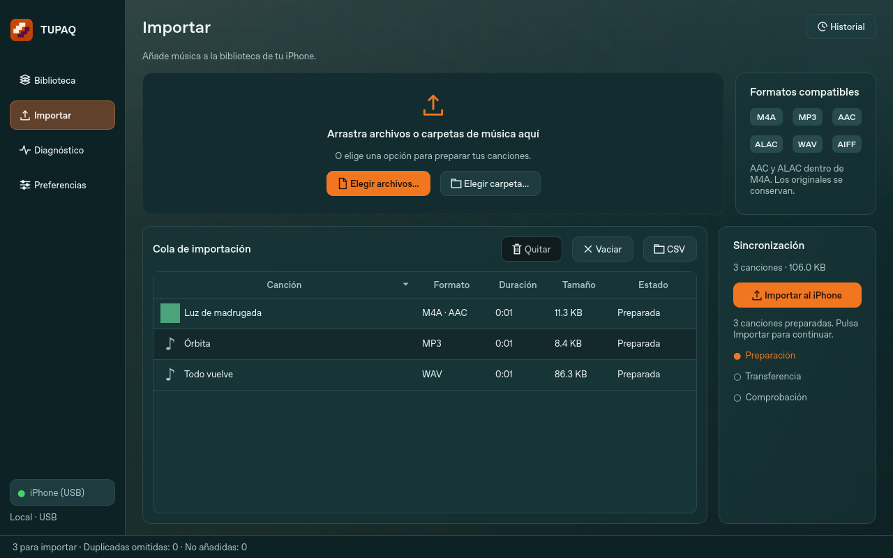
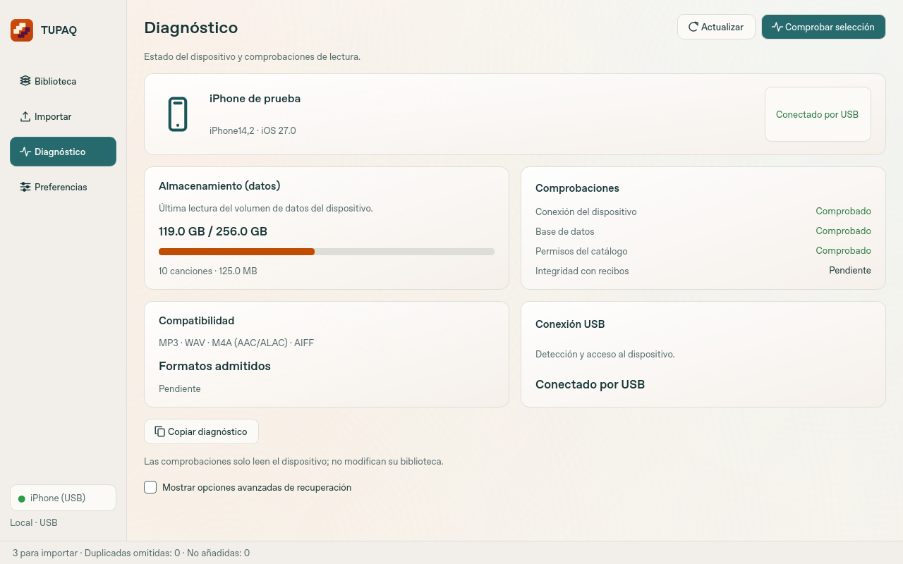
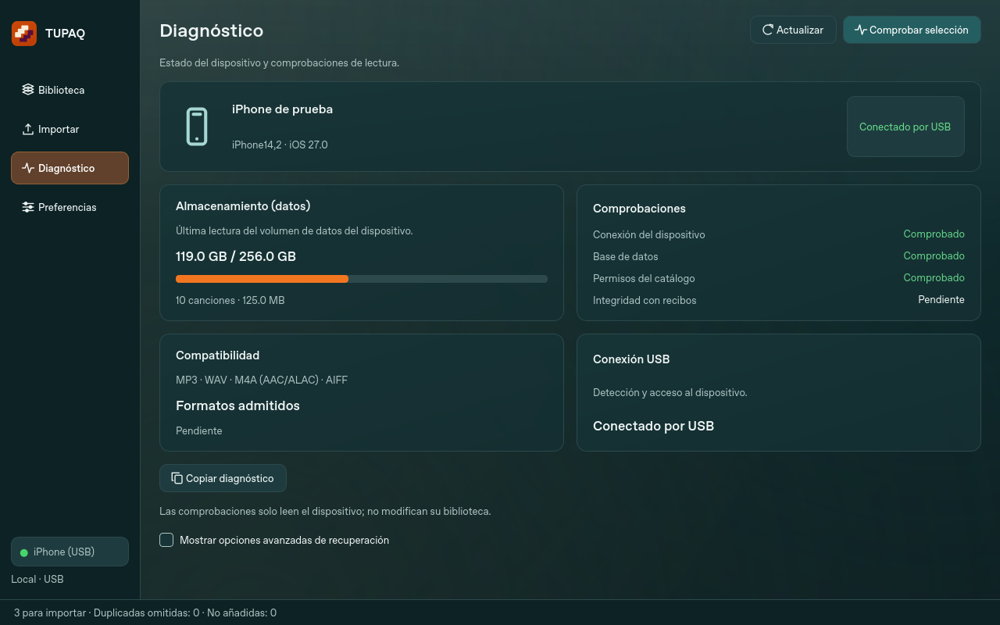
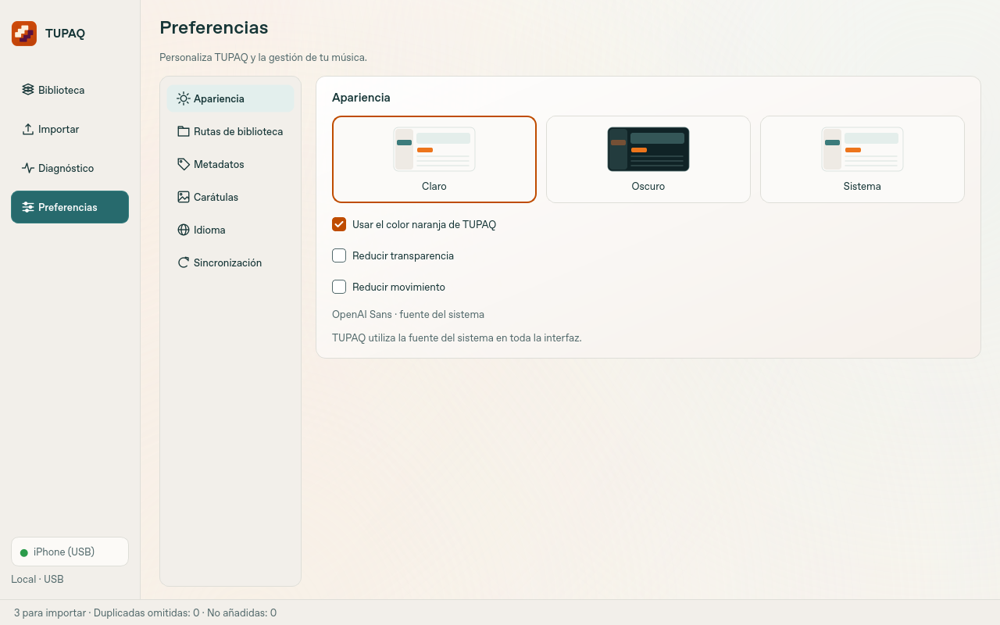
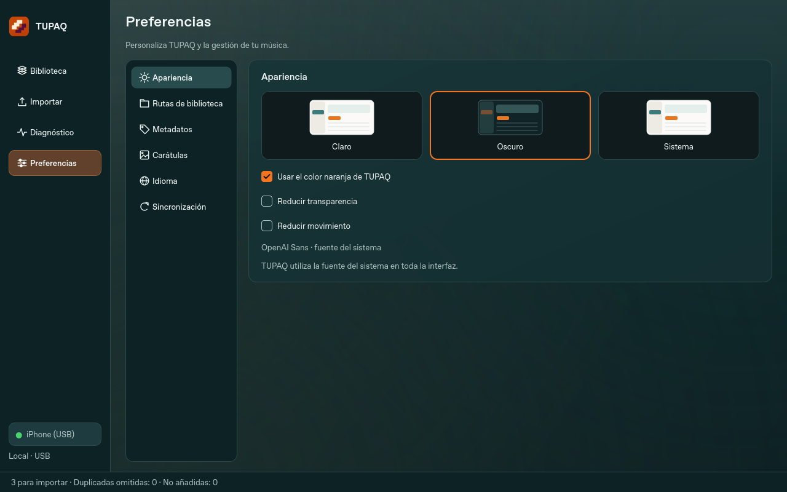

# Diseño claro y oscuro · 0.3.0-preview.25

Capturas de los widgets reales de la aplicación con datos sintéticos. No son
maquetas generadas ni una conexión a un teléfono real. Se renderizaron en Linux;
Windows y macOS usan su propia fuente nativa. El cambio de fuente no se ofrece
como preferencia de la aplicación.

| Vista | Claro | Oscuro |
| --- | --- | --- |
| Biblioteca |  |  |
| Importar |  |  |
| Diagnóstico |  |  |
| Preferencias |  |  |

## Funciones de las referencias

- Archivos o carpetas, cola, miniaturas, estados por canción y progreso real.
- Historial agregado de las últimas operaciones, sin nombres de canciones ni IDs.
- Importar, exportar, seleccionar y eliminar; filtros de formato, portada y letra.
- Claro/Oscuro/Sistema, acento opcional, reducir transparencia y movimiento.
- Carpeta inicial de música, política de títulos y opciones de carátula.
- Activación opcional de importación automática y actualización por cambios.
- Diagnóstico con nombre/modelo/iOS conocidos, almacenamiento de datos comunicado
  por AFC y comprobaciones de conexión, catálogo, lectura y hashes conocidos.
- Pausa/reanudación entre lotes o archivos y cancelación segura.

Formatos: MP3, WAV, M4A con AAC/ALAC y AIFF. **FLAC se excluye** por indicación
del usuario. Los chips AAC/ALAC indican códecs dentro del contenedor M4A.

## Alcance de los controles

**Metadatos** conserva las etiquetas de forma predeterminada o usa el nombre del
archivo como título del próximo envío. No reescribe el original ni actualiza a
ciegas canciones ya importadas con el mismo hash.

**Carátulas** controla el asset de portada enviado al catálogo. Desactivarlo no
quita la portada ya incrustada en el original. Incrustar carátulas al exportar
completa únicamente copias locales sin portada, con JPEG/PNG disponibles de hasta
20 MiB. Se conserva una portada existente y se verifica el audio antes de modificar
la copia; el iPhone permanece intacto. Los `.m4p` no se modifican ni descifran.

**Importación automática** está desactivada inicialmente. La cola solo se envía
si continúa conectado el mismo teléfono, existe una lectura válida y coincide
el token efímero del dispositivo antes de escribir. No se activa simplemente al
conectar un teléfono a una cola preparada anteriormente.

**Actualización por cambios** comprueba atributos de DB/WAL cada 30 segundos,
además de releer después de transferir. No descarga todos los audios en el sondeo,
no se ejecuta durante otras operaciones USB y mantiene la última vista válida.
Desactivarla no desactiva la verificación del envío.

**Comprobar todo** lee de principio a fin los audios accesibles del catálogo fresco;
si hay canciones marcadas, el botón cambia a Comprobar selección. Los hashes se
comparan solo contra recibos propios de la misma biblioteca y archivo. Una lectura
completa sin hash previo no se presenta como autenticación de ese archivo. No se
inventan resultados sobre permisos generales del sistema, velocidad USB o versiones
de iOS que no se han probado. El espacio es el volumen de datos comunicado por AFC,
no una estimación a partir del modelo comercial.

**Pausa** se aplica al terminar la transacción o archivo en curso. El botón se ofrece
para operaciones con límites de pausa seguros; no corta a mitad una transacción
ATC. El historial no reemplaza los recibos ni las copias del catálogo y conserva
hasta 500 resúmenes locales; la ventana muestra los 200 más recientes.

## Reproducir las capturas y verificaciones

```bash
QT_QPA_PLATFORM=offscreen .venv/bin/python scripts/preview_desktop.py --output /tmp/tupaq-preview
QT_QPA_PLATFORM=offscreen .venv/bin/python -m unittest discover -s tests -v
```

215 pruebas en la revisión: tipografía nativa sin selección de fuentes, ambas
apariencias a 1080 px, filtros y selección, políticas de metadatos, copias con
carátula, lectura completa y corrupción respecto a recibos, pausa de un envío
nativo después de sus primeras 49 canciones, cambio de dispositivo y límites.

Se prepararon 10.000 archivos en la interfaz nueva, con 96 miniaturas iniciales:
12,568 s, pausa máxima observada del temporizador de interfaz de 325 ms y unos
207 MiB de memoria residente máxima del proceso. Son medidas locales de Linux,
con datos sintéticos y otra batería de pruebas ejecutándose al mismo tiempo;
no predicen rendimiento USB ni sustituyen pruebas físicas en Windows/macOS.
[Resultado](stress/preparation-10000-preview25.json).
