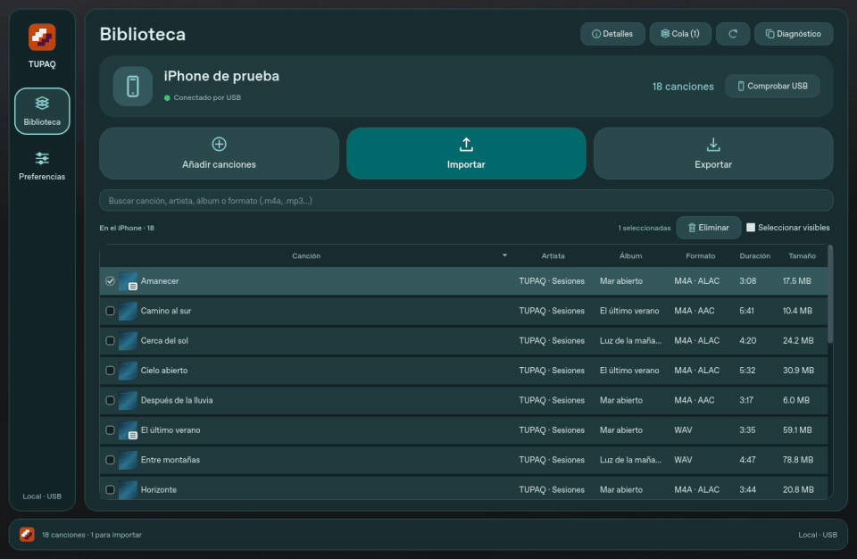

# Interfaz y tipografía — preview.19

## Dirección visual

La revisión toma como referencia visual las superficies tonales, agrupación de controles y claridad de estados de Tellyscope, y las transiciones breves, jerarquía y respuesta al arrastre de LocalSend. La implementación de TUPAQ es original en Qt: no se incorporan sus fuentes, iconos, código ni sistemas de transferencia. No se añade Flutter, Android ni un motor web.

- Nueva composición: navegación compacta, tarjeta del iPhone y tres acciones grandes (Añadir, Importar y Exportar), con biblioteca a todo el ancho. La identidad Encuentro se conserva en la marca; los controles usan superficies verde azulado en el modo Tonal.
- Detalles abre una ventana secundaria con carátula y propiedades; ya no ocupa una columna permanente. El botón mantiene su estado al cerrar con la X o Escape.
- Superficies con niveles de contraste y radios amplios consistentes.
- Preferencias agrupadas en apariencia/idioma, tipografía y conexión. Las herramientas avanzadas permanecen plegadas.
- Estados reales de inicio, lectura y búsqueda sin coincidencias, con acciones contextuales.
- Al arrastrar archivos locales aparece una zona clara para soltarlos. Solo prepara la cola; no comienza la importación. Los enlaces web no se presentan como archivos locales.
- Buscar con Ctrl+F / Cmd+F y abrir canciones con Ctrl+O / Cmd+O.
- La selección, búsqueda, posición y casillas siguen conservándose al navegar y actualizar.

## Movimiento y recursos

Respuestas de hover de 120 ms, selección/navegación y carátulas de 180 ms, con salida cúbica. Se usa un único fotograma temporal para la transición entre Biblioteca y Preferencias, con límite de ocho millones de píxeles físicos; se libera al terminar o redimensionar. Los clics quedan absorbidos durante esos 180 ms para evitar activar un control que todavía no se ve. No se anima la lectura/actualización del catálogo ni se desvanecen las canciones al refrescar.

Las carátulas conservan la imagen visible durante la mezcla y eliminan la anterior al terminar. Volver a mostrar el mismo original no reinicia la mezcla ni dibuja una miniatura encima. Las animaciones son finitas, por eventos: no hay temporizadores decorativos activos en reposo ni desenfoque continuo.

Preferencias → Reducir movimiento detiene lo activo y muestra inmediatamente su estado final. La opción persiste. No cambia el protocolo USB, el ritmo real de una transferencia ni sus comprobaciones.

## Mori en Windows: instalación personal

La fuente aportada tiene licencia personal; sus archivos no se incluyen en el repositorio, instaladores públicos, pruebas ni artefactos de CI. TUPAQ detecta la familia **PP Mori** instalada mediante las funciones normales de Windows. No descarga, instala ni carga archivos de fuentes elegidos desde la interfaz.

1. Extrae tu archivo `Mori.zip`.
2. Selecciona `PPMori-Regular.ttf`, `PPMori-Medium.ttf`, `PPMori-SemiBold.ttf` y `PPMori-Bold.ttf`.
3. Clic derecho → Instalar (en Windows 11 puede aparecer dentro de Mostrar más opciones).
4. Cierra TUPAQ y vuelve a abrirlo. Preferencias mostrará «Mori · tipografía de Windows».

Se usa un cuerpo de 14 píxeles lógicos con los pesos reales 400/500/600/700. Columnas y controles se ajustan a sus métricas. La aplicación conserva el escalado de pantalla de Qt. No se fuerzan pesos sintetizados si están instalados los cuatro pesos. Los caracteres que Mori no incluya recurren al fallback normal del sistema.

Si Mori no está instalada se usa y se identifica la fuente del sistema, sin afirmar que sea Mori. No se ofrece un selector, botón Agregar fuente ni Aplicar. Las preferencias antiguas no sustituyen la tipografía fija. En **macOS siempre se usa la fuente del sistema**, aunque Mori esté instalada.

## Comprobaciones

Pruebas de selección/cola tras navegar y refrescar, finalización y liberación de animaciones, reducir movimiento durante una transición, mezcla de carátulas sin cuadros vacíos, estados vacíos y arrastre sin importación automática. La comprobación local con los archivos personales de Mori verifica los pesos reales, la familia en controles/tablas/diálogos y el espacio de las columnas. Esos archivos no viajan a GitHub. Las pruebas de CI cubren el comportamiento con la fuente instalada o su ausencia. Las capturas públicas se renderizan con la fuente disponible del entorno; la vista personal de Mori se mantiene fuera del repositorio.
